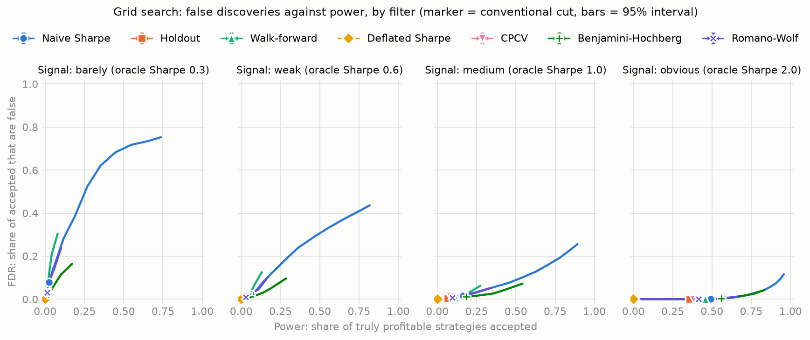
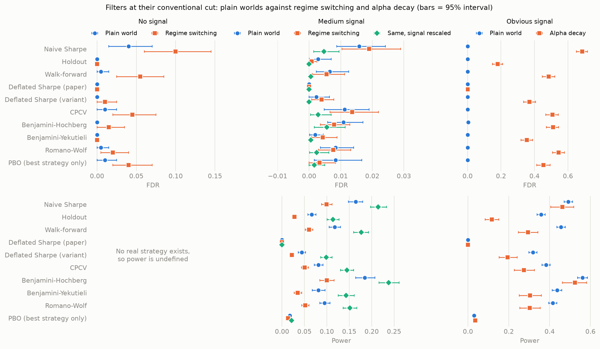
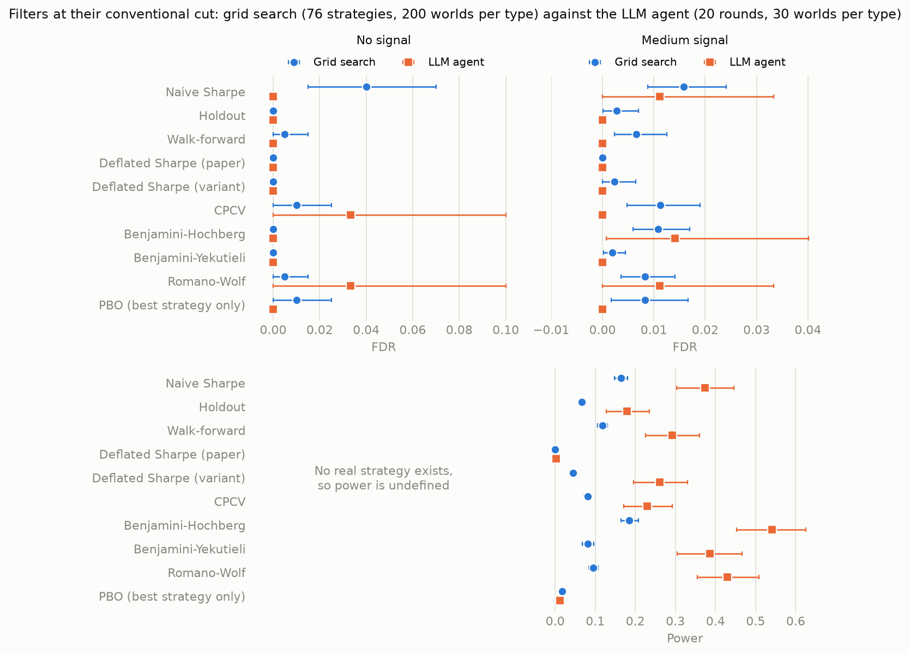
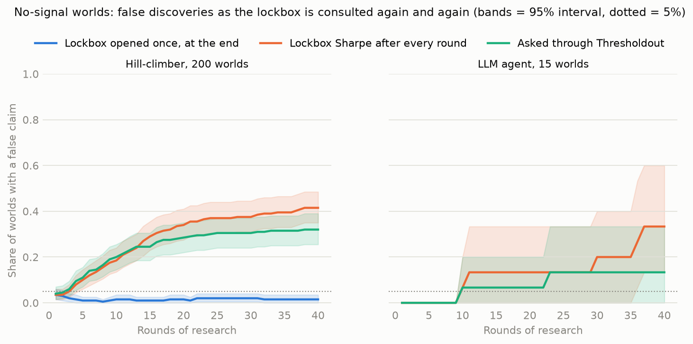

# Backtest Overfitting Lab

**Stages 1–5 complete; Stage 6 (real-data check) in progress.**

**Question:** when many trading strategies are backtested on the same data,
which statistical filters stop the false discoveries, and how many real
strategies do they throw away in the process?

**Approach:** simulated markets where the truth is known (no signal, or a
planted signal of known strength), a strategy generator that tries many ideas,
and filters that decide which ideas to believe. False discovery rate and power
are measured over hundreds of simulated worlds.

**Key results so far:**

- With a grid of 76 strategies and a medium-strength signal, every filter
  keeps the false discovery rate at 1.6% or below; what separates them is
  power: Benjamini-Hochberg finds 18.5% of the real strategies, Romano-Wolf
  9.5%, a single holdout 6.6%, and the deflated Sharpe ratio as published
  none ([tables](results/exp1_grid_tables.md)).
- No filter protects against a signal that fades: with alpha decay, 35% to
  69% of what the research-sample filters accept is worthless
  ([Stage 3 note](results/stage3.md)).
- A Claude Haiku agent writing its own strategies proposes far more real ones
  than the grid (68% to 85% against 24% to 42% on signal worlds), and the
  same filters accept more of them with a false discovery rate of 1.4% or
  below; but it proposes the planted textbook signals before seeing any data,
  so this measures prior knowledge as much as research
  ([Stage 4 note](results/stage4.md)).
- Reporting the lockbox result after every round raises false claims on noise
  from 1.5% (lockbox opened once) to 41.5% for a simple hill-climber.
  Thresholdout at its declared settings only brings this to 32%, and the
  lockbox stays honest (7% of the chosen strategies really clear the bar)
  only when the answers are so noisy that 90% of the claims made from them
  are false ([Stage 5 note](results/stage5.md)).
- Whether knowing the filters helps an agent game them could not be tested:
  on noise no agent strategy ever passed a check, so the feedback carried no
  information ([Stage 5 note](results/stage5.md)).



## How to read the numbers

- **True strategy.** A strategy counts as real in a world type if its long-run
  Sharpe ratio after costs is at least 0.2 a year, measured on 10,000 fresh
  simulated years (standard error about 0.01). Thresholds 0 and 0.5 are
  reported as a sensitivity check.
- **FDR.** In each world, V is the number of accepted strategies that are not
  real and R the number accepted. The false discovery proportion is
  V / max(R, 1), so a world where nothing is accepted counts as zero. FDR is
  its average over worlds.
- **pFDR** (positive FDR, Storey 2003) is the same average over only the worlds
  where something was accepted: "when this filter says yes, how often is it
  wrong?". FDR = pFDR x share of worlds with an acceptance, so a filter that
  rarely accepts anything can have a low FDR and a high pFDR. Both are in the
  tables.
- **Power** is the share of the real strategies that a filter accepts.
- **The filters test a different hypothesis than the truth label.** Every
  filter with a test asks "is the mean return above zero?". The truth label
  asks "is the Sharpe at least 0.2?". A strategy with a true Sharpe of 0.1 is
  a correct rejection of "mean = 0" and still counts as a false discovery
  here. This is deliberate (an edge that small is not worth trading), but it
  means a filter can exceed its nominal 5% without being broken.
- **The noise worlds are an easier null than "mean = 0".** With no signal a
  strategy earns nothing before costs and pays costs on every trade, so its
  true Sharpe is negative: -0.22 on average over the 76 grid strategies, from
  -0.95 to 0.00. A test of "mean = 0" on them is conservative, so the
  false-positive rates in the no-signal rows are lower than the same filters
  would show on strategies with a true mean of exactly zero.

## Results so far

Brute-force grid search of 76 strategies against ten filters: naive Sharpe
threshold, single holdout, walk-forward, deflated Sharpe ratio (as published
and a variant), combinatorial purged cross-validation, Benjamini-Hochberg,
Benjamini-Yekutieli, Romano-Wolf and the probability of backtest overfitting.
All tables: [results/exp1_grid_tables.md](results/exp1_grid_tables.md). Notes:
[Stage 1](results/stage1.md), [Stage 2](results/stage2.md),
[Stage 3](results/stage3.md).

**Headline so far: no filter protects against a signal that fades.** When the
planted signal halves every 5 years, a strategy can look like Sharpe 1 in the
backtest and be worth almost nothing afterwards. At the 0.2 threshold,
35% to 69% of what the research-sample filters accept is worthless (FDR), and
in the worlds where a filter accepts anything at all, 86% to 89% is (pFDR).
Multiple-testing corrections do not help, and that is not a flaw in them: they
answer "was there an edge in this sample?", and the answer is correctly yes.
The holdout has the lowest FDR (18%), but through recency, not statistics: its
lockbox is the most recent 3 years, where the signal has already faded, so it
says yes in fewer worlds (23%). When it does say yes, 79% of what it accepts
is still worthless. Details in the [Stage 3 note](results/stage3.md).



**The deflated Sharpe ratio, applied as published, accepts nothing.** In 4,600
simulated worlds it passed no strategy, even where the planted Sharpe is 2.
Its benchmark is built from the variance of the trials' Sharpe ratios and
assumes that this variance is pure estimation noise. On a grid where
strategies differ for real (those that follow a signal against their mirror
images), the variance measures real spread, and the benchmark rises above the
best strategy. A variant that uses the estimation variance under "no edge" and
an effective number of independent trials accepts nothing on noise and finds
32% of the real strategies when the signal is obvious. Details in the
[Stage 2 note](results/stage2.md).


## The LLM agent (Stage 4)

A language model plays the researcher: each round it writes a hypothesis and
a `positions(prices)` function, the function is checked, run in a sandbox with
the look-ahead test, backtested by the same engine as the grid, and the model
is told the result on the research sample.

**Run:** Claude Haiku 5.5, 20 rounds per world, 30 worlds each of no signal
and the three medium signals (the grid's world seeds 0 to 29): 120 runs, 2,510
calls, $0.83. Every usable strategy's true Sharpe was measured on the same
10,000 simulated years as the grid's. Full note:
[results/stage4.md](results/stage4.md).

- **Usable rounds:** 99.2% [98.7, 99.6] of 2,400 (95% interval over the 120
  runs); 20 rounds stayed unusable after two repairs. The look-ahead test
  rejected 2 of 2,510 attempts (0.08%), and both were repaired.
- **Share of true strategies:** 85%, 84% and 68% of the agent's strategies on
  momentum, cross-sectional and mean-reversion worlds, against 42%, 38% and
  24% of the grid's 76. None on no-signal worlds for either.

Filters at their conventional cut, truth threshold 0.2, percent with 95%
intervals over worlds (agent 30 worlds per type, grid 200):

| Filter | No signal: FDR agent | No signal: FDR grid | Medium: FDR agent | Medium: FDR grid | Medium: power agent | Medium: power grid |
|---|---|---|---|---|---|---|
| Naive Sharpe | 0.0 [0.0, 0.0] | 4.0 [1.5, 7.0] | 1.1 [0.0, 3.3] | 1.6 [0.9, 2.4] | 37.4 [30.4, 44.6] | 16.4 [14.8, 18.0] |
| Holdout | 0.0 [0.0, 0.0] | 0.0 [0.0, 0.0] | 0.0 [0.0, 0.0] | 0.3 [0.0, 0.7] | 17.9 [12.7, 23.6] | 6.6 [5.8, 7.6] |
| Walk-forward | 0.0 [0.0, 0.0] | 0.5 [0.0, 1.5] | 0.0 [0.0, 0.0] | 0.7 [0.2, 1.2] | 29.1 [22.6, 36.1] | 11.8 [10.5, 13.1] |
| Deflated Sharpe (paper) | 0.0 [0.0, 0.0] | 0.0 [0.0, 0.0] | 0.0 [0.0, 0.0] | 0.0 [0.0, 0.0] | 0.2 [0.0, 0.7] | 0.0 [0.0, 0.0] |
| Deflated Sharpe (variant) | 0.0 [0.0, 0.0] | 0.0 [0.0, 0.0] | 0.0 [0.0, 0.0] | 0.2 [0.0, 0.7] | 26.0 [19.6, 33.0] | 4.4 [3.6, 5.2] |
| CPCV | 3.3 [0.0, 10.0] | 1.0 [0.0, 2.5] | 0.0 [0.0, 0.0] | 1.1 [0.5, 1.9] | 22.9 [17.2, 29.2] | 8.1 [7.2, 9.1] |
| Benjamini-Hochberg | 0.0 [0.0, 0.0] | 0.0 [0.0, 0.0] | 1.4 [0.1, 4.0] | 1.1 [0.6, 1.7] | 54.1 [45.3, 62.6] | 18.5 [16.5, 20.7] |
| Benjamini-Yekutieli | 0.0 [0.0, 0.0] | 0.0 [0.0, 0.0] | 0.0 [0.0, 0.0] | 0.2 [0.0, 0.4] | 38.5 [30.4, 46.7] | 8.1 [6.7, 9.6] |
| Romano-Wolf | 3.3 [0.0, 10.0] | 0.5 [0.0, 1.5] | 1.1 [0.0, 3.3] | 0.8 [0.4, 1.4] | 42.9 [35.4, 50.8] | 9.5 [8.4, 10.7] |
| PBO (best only) | 0.0 [0.0, 0.0] | 1.0 [0.0, 2.5] | 0.0 [0.0, 0.0] | 0.8 [0.2, 1.7] | 1.2 [0.5, 2.2] | 1.8 [1.6, 1.9] |

"Medium" pools the three signal types (agent 90 worlds, grid 600). pFDR and
the per-type tables are in [results/stage4.md](results/stage4.md). How to read
it:

- **Power is not comparable one to one.** It is the share of each
  generator's *own* true strategies that a filter accepts. The agent's true
  strategies are few and mostly strong; the grid's include many weak ones.
- **The agent tries about 20 strategies per world, the grid 76**, so the
  multiple-testing corrections charge it less.
- **30 worlds per type give wide intervals.** The agent's 3.3% for CPCV and
  Romano-Wolf on no-signal worlds is one world each.
- **On noise, costs lower both generators' false positives, but not the gap
  between them.** Costs take 0.22 off the research Sharpe of agent and grid
  strategies alike (similar turnover, about 36 to 38 a year). Without costs
  the naive filter would pass something in 11.0% of no-signal worlds for the
  grid and 3.3% for the agent, against 4.0% and 0% with costs. The agent's
  lower rate comes from trying 20 strategies per world instead of 76, not
  from costs. Details in [results/stage4.md](results/stage4.md); the
  zero-cost numbers come from [scripts/zero_cost.py](scripts/zero_cost.py).



How the agent is set up:

- **What the agent remembers.** By default every round is a fresh prompt with
  a table of all its past rounds (hypothesis, status, research-sample Sharpe)
  and the error of the last round if it failed. It sees every result it ever
  got, so it stays adaptive. The first version kept one growing conversation
  with all earlier code instead; a small local model then copied its own
  mistakes round after round and the prompt reached 14,000 tokens in 20
  rounds (1,800 with the table). The old mode is still there:
  `--history transcript`. The price of the table: the agent no longer sees its
  earlier code, only what each idea was and how it scored.
- **Repairs.** If a round's code cannot be used (error, look-ahead, a repeat),
  the model gets the reason and up to two more attempts. Only the final
  version is a trial. Failed code was never backtested, so it told the model
  nothing about the data and does not count as a trial for the corrections.
- **Reproducibility.** Every model reply is stored under a hash of the full
  request and committed to this repo (`cache/llm/`). Experiments are re-scored
  from those files without calling a model. For the Claude runs the stored
  replies are the only reproducibility guarantee: the model accepts neither a
  seed nor a temperature, so a fresh run would produce different strategies.
  The files hold the replies, token counts, timing and cost, and nothing else.
- **What the agent already knows.** The planted signals (momentum,
  cross-sectional momentum, short-term reversal) are textbook ideas, and the
  model has read the textbooks. It proposes them without seeing any data (in
  round 1, before any result, 117 of 120 replies describe a cross-sectional
  or relative idea, 79 a momentum idea, 41 a reversal idea), so its power and
  its high share of true strategies partly reflect prior knowledge, not
  discovery from the backtests. A signal that is in no textbook would be a
  harder and fairer test.

### Which model, and why it changed

The plan was to run the bulk of the agent experiments on a free local model
and add a small comparison on Claude Haiku 5.5. The local models did not get
through the gate set beforehand (about 80% of rounds must give a usable,
look-ahead-free strategy), so the bulk now runs on Haiku under a hard cap of
$2.00 for all API calls, checked in code before every call.

Pilot: one agent run of 20 rounds on each of two worlds (no signal, medium
momentum), same prompt for every model.

| Model | Usable rounds | Look-ahead rejections | Distinct strategies | Seconds per round | Cost |
|---|---|---|---|---|---|
| Claude Haiku 5.5 | 40 of 40 (100%) | 0 | 38 | 2.7 | $0.014 |
| qwen2.5-coder:7b (local, 4.7 GB) | 4 of 40 (10%) | 19 | 4 | 39 | free |
| mimo-v2.6:9b (local, 6.6 GB), first world only | 3 of 20 (15%) | 10 | 3 | 50 | free |

Most failed rounds of the local models ended in a plain error: weights of the
wrong shape, or pandas arguments that do not exist (28 of the 7B model's 36
failed rounds, 14 of mimo's 17). The second cause was look-ahead: dividing by
a full-sample sum, which the automated test rejected (7 and 3 failed rounds;
19 and 10 rejected attempts when repairs are counted).
Two larger local models could not be tested on a 16 GB laptop: one
ran it out of memory, one did not load in the installed Ollama version.
Details: [results/pilot/STATUS.md](results/pilot/STATUS.md).

## Holdout reuse and the Goodhart test (Stage 5)

Results only; the interpretation follows after review. Full note:
[results/stage5.md](results/stage5.md).

**Experiment 2: a lockbox asked after every round.** An analyst proposes a
strategy per round for 40 rounds and after each asks how it did in the lockbox
(the last 3 years). Whatever answered best so far is the candidate; a
discovery is claimed when the answer is above 0.95, the bar of a one-sided 5%
test on 3 years. The lockbox is either opened once at the end (the correct
use), reported after every round, or asked through Thresholdout (Dwork et al.
2015: it answers with the research Sharpe unless the lockbox disagrees by more
than a noisy threshold, then with a noisy lockbox value, within a budget).
Declared Thresholdout settings: threshold 1 standard error of the lockbox
Sharpe (0.58), noise rate a twenty-fifth of that, budget 10.

Share of no-signal worlds with a (false) claim after 40 rounds, 95% intervals
over worlds. "Told": the declared rule, on the answer the analyst got.
"Actual": the candidate's real lockbox Sharpe above 0.95, added afterwards.

| Analyst | Lockbox opened once | Reported every round, told = actual | Thresholdout, told | Thresholdout, actual |
|---|---|---|---|---|
| Hill-climber over the 76 grid strategies, 200 worlds | 1.5 [0.0, 3.5] | 41.5 [35.0, 48.5] | 32.0 [25.5, 39.0] | 31.0 [24.5, 37.5] |
| Haiku agent, 15 worlds per arm | (not run) | 33.3 [13.3, 60.0] | 13.3 [0.0, 33.3] | 13.3 [0.0, 33.3] |

- **The agent's two arms do not differ significantly.** They ran on the same
  15 worlds: reuse claimed in 5, Thresholdout in 2, and the 3 worlds where
  they disagree all go the same way. Exact McNemar test on those 3: p = 0.25,
  on either rule.
- **"Opened once" is below 5% mostly because of costs.** 3 claims in 200
  worlds would be unlikely at a true 5% rate (p = 0.009), but the bar is the
  5% point for a true Sharpe of 0, and the chosen strategies lose 0.09 a year
  after costs. For them the expected rate is 3.7%, and 3 of 200 is within
  chance (p = 0.057). At zero cost the same strategies give 5 claims of 200
  ([results/zero_cost.md](results/zero_cost.md)).

- Thresholdout answered from the lockbox in 45% of the hill-climber's answered
  rounds and 43% of the agent's. Its budget ran out in 83% of hill-climber
  runs (median round 21) and 9 of 15 agent runs (median round 16).
- Sensitivity runs, hill-climber only, added after the first results: noise
  at the paper's scale (noise rate 2 standard errors: 90% false claims on the
  told rule, 7.0% [3.5, 10.5] on the actual lockbox; the paper's ratios,
  threshold 4 and noise 1 standard error: 54.5% and 12.5%), and a 12-year
  lockbox (reported every round 33.5%, Thresholdout 24.0% told and 18.0%
  actual, opened once 2.0%). Thresholds 0.5 to 4 and budgets 5 and 40 are in
  the note, as are the medium-momentum worlds.



**Experiment 3: told the filters or not.** On 15 no-signal worlds, 20 rounds,
two agent arms see the same table of which of six anonymised checks (A to F:
holdout, walk-forward, deflated Sharpe, CPCV, Benjamini-Hochberg,
Romano-Wolf) each past strategy passes, with the same goal; only one arm is
told what the checks are.

- **A documented null.** No strategy passed any check in any of the 600
  prompts, so both arms saw "none" in every row and got no information to
  act on; the experiment cannot show whether knowing the checks helps an
  agent game them. Costs are not the reason: at zero cost the same strategies
  still pass no check and no filter
  ([results/zero_cost.md](results/zero_cost.md)). Twenty noise strategies
  rarely reach these bars at all. It was not re-run; a fair test needs checks
  that noise passes often enough to learn from.
- No filter accepted any strategy in either arm (the Stage 4 agent, which saw
  only its Sharpe ratios, had one world of 15 passing CPCV and one passing
  Romano-Wolf).
- The told arm's strategies were slightly less correlated with each other
  (mean absolute correlation 0.32 against 0.38; paired difference -0.06
  [-0.13, 0.01]).

**Cost:** $0.79 for 1,900 calls; $1.63 of the $2.00 cap spent in all.

## Setup and usage

```bash
uv sync
uv run pytest -q
uv run python -m overfitlab all          # every experiment, from stored model replies
uv run python -m overfitlab all --quick  # small check run, writes to results/quick
uv run python -m overfitlab agent        # only the agent experiment, from stored replies
uv run python -m overfitlab exp2         # holdout reuse: hill-climber and agent
uv run python -m overfitlab exp3         # told against not told
uv run python scripts/zero_cost.py --jobs 6  # the same strategies without costs
```

`all` makes no model call. The one command that does is
`uv run --env-file .env python -m overfitlab generate`, which needs
`ANTHROPIC_API_KEY` in a git-ignored `.env` file, skips every reply that is
already stored and stops before the spending cap.

All randomness derives from one master seed (`20261116` in
`src/overfitlab/config.py`).

## Limitations

- **Simulated markets.** They have fat tails, volatility clustering, correlated
  assets, and optionally regime switching and alpha decay, but are far simpler
  than real markets.
- **Regime switching and signal strength are only partly separated.** Scaling
  the signal back up matches the planted rule's Sharpe, not how hard the world
  is for the grid; the comparison is clean for one of three signal types.
- **Daily data only.**
- **Thresholdout runs outside its guarantee.** The theorem needs statistics
  bounded in [0, 1] and a holdout far larger than the budget over the squared
  accuracy; a Sharpe ratio on 756 days is neither. The settings were chosen in
  standard errors before the runs, and the paper's own figures (10,000
  samples, threshold 0.04, noise 0.01) come from a summary of the paper, not
  from the original.
- **Experiment 3 gave the agent nothing to game.** No strategy ever passed a
  check, so the feedback both arms saw was constant. The design does not test
  what happens when the checks can be passed.
- **Small agent samples.** 15 worlds per arm in Experiments 2 and 3: one world
  moves a share by 6.7 points.
- **Two methods rest on secondary sources.** The CPCV chapter (Lopez de Prado
  2018) and the paper behind the effective number of trials (Galwey 2009) are
  not freely available. CPCV follows a library's documentation and my own
  derivation of the split and path counts; the effective-trials formula comes
  from an R package's documentation. Neither was checked against the original.
- **The CPCV accept rule is my own.** The book gives the paths, not a decision
  rule; the one used here is stated and tested in the Stage 2 note.
- **Alpha decay is tested in one setting.** One half-life (5 years) on one
  signal strength (obvious). A slower decay or a weaker signal would give
  different numbers; the direction of the result is what carries over.
- **One model, one prompt.** The agent results come from Claude Haiku 5.5 with
  one prompt, 30 worlds per type. Another model or prompt could propose
  different strategies.
- **Not finished.** The real-data check (Stage 6) is still to come.
