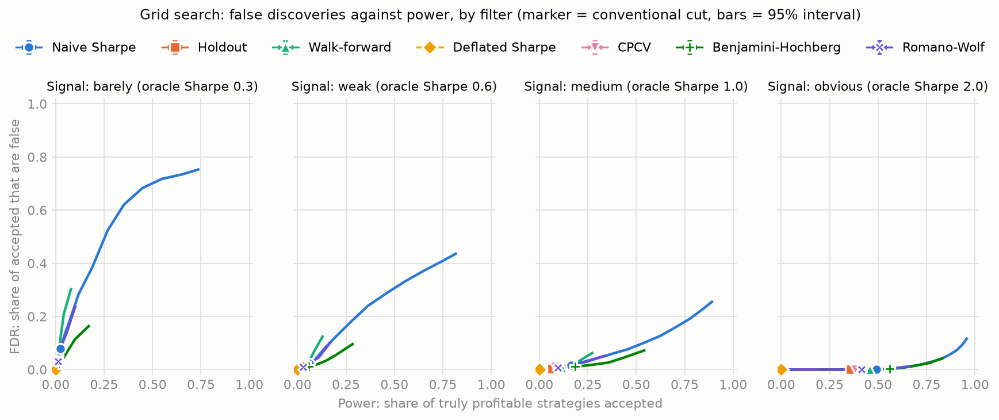

# Stage 1 results: grid search against the three everyday filters

> Added later: pFDR next to FDR for every filter, in
> [exp1_grid_tables.md](exp1_grid_tables.md) and explained in the
> [Stage 3 note](stage3.md).

Reproduce with `uv run python -m overfitlab all` (about 5 minutes on 8 cores).
Master seed `20261116`; every world and every truth path has its own stream
derived from it (`config.seed`).

## Setup

- **Worlds.** 10 correlated assets, 2,520 days, Student-t shocks (6 degrees of
  freedom) with GARCH(1,1) variance. Measured on the null world: kurtosis 7.3
  (a normal has 3), autocorrelation of squared returns 0.12 at lag 1, mean
  pairwise correlation 0.26, no detectable drift.
- **13 world types.** One with no signal, and three planted signals
  (time-series momentum, cross-sectional momentum, 5-day mean reversion) at four
  strengths. Strength is set so that the strategy trading the planted rule
  itself earns a net Sharpe of about 0.3, 0.6, 1.0 or 2.0. Measured values:
  0.28 to 0.33, 0.57 to 0.62, 0.97 to 1.01, 1.97 to 2.01.
- **Generator.** Brute-force grid of 76 strategies (38 rules, each followed and
  faded). All pass the automated look-ahead test.
- **Costs.** 5 bps per unit of turnover, inside the engine.
- **Data rule.** First 70% (7 years) is the research sample, last 30% the lockbox.
- **200 worlds per world type**, 2,600 in total.

## Ground truth

Each strategy's long-run net Sharpe is measured on 10,000 fresh simulated years
per world type (100 independent 100-year paths). Standard error of that "true"
Sharpe: median 0.010, largest 0.014, so about 5% of the 0.2 threshold.

- A strategy is a **true discovery** if its true Sharpe is at least 0.2.
- In the no-signal world the best of the 76 has a true Sharpe of -0.003 and the
  average is -0.22: costs make everything lose, as intended.
- Depending on the world type, between 3 and 34 of the 76 strategies are true.
- 18 of 912 strategy labels (2%) lie within 2 standard errors of the 0.2
  threshold and could be mislabelled; the worst case is 7 of 76 in the
  barely-detectable cross-sectional world.

## Filters at their conventional settings

Naive: research-sample Sharpe at least 1.0. Holdout: same screen, then lockbox
t-test at 5%. Walk-forward: traded each year only if the screen was passed on
all earlier data, then a 5% t-test on the traded days. Brackets are 95%
bootstrap intervals over worlds.

| Worlds | Filter | FDR | Power | Accepted per world |
|---|---|---|---|---|
| No signal | Naive | 4.0% [1.5, 7.0] | n/a | 0.06 |
| No signal | Holdout | 0.0% (0 of 200 worlds) | n/a | 0.00 |
| No signal | Walk-forward | 0.5% [0.0, 1.5] | n/a | 0.005 |
| Barely (0.3) | Naive | 7.8% [5.9, 9.9] | 2.6% [1.8, 3.4] | 0.48 |
| Barely (0.3) | Holdout | 0.4% [0.0, 0.9] | 0.3% [0.1, 0.5] | 0.03 |
| Barely (0.3) | Walk-forward | 1.8% [1.0, 2.8] | 1.0% [0.6, 1.5] | 0.15 |
| Weak (0.6) | Naive | 2.2% [1.2, 3.3] | 6.2% [5.2, 7.4] | 1.5 |
| Weak (0.6) | Holdout | 0.5% [0.0, 1.0] | 1.3% [0.9, 1.7] | 0.30 |
| Weak (0.6) | Walk-forward | 1.1% [0.5, 2.0] | 3.3% [2.6, 4.2] | 0.79 |
| Medium (1.0) | Naive | 1.6% [0.9, 2.4] | 16.4% [14.8, 18.0] | 4.8 |
| Medium (1.0) | Holdout | 0.3% [0.0, 0.7] | 6.6% [5.8, 7.6] | 1.9 |
| Medium (1.0) | Walk-forward | 0.7% [0.2, 1.3] | 11.8% [10.5, 13.1] | 3.4 |
| Obvious (2.0) | Naive | 0.1% [0.0, 0.2] | 49.1% [47.1, 51.3] | 16.1 |
| Obvious (2.0) | Holdout | 0.0% [0.0, 0.0] | 35.8% [33.8, 37.8] | 11.8 |
| Obvious (2.0) | Walk-forward | 0.0% [0.0, 0.0] | 45.6% [43.5, 47.7] | 14.9 |

In the no-signal world every accepted strategy is false, so FDR there equals
the share of worlds with at least one false discovery.

## What the numbers say

**The naive rule is safer than its reputation here, but only at a strict cut.**
A Sharpe of 1.0 over 7 years is a t-statistic of about 2.6, so on pure noise
only 4% of worlds produce a false discovery even after 76 tries. The protection
disappears quickly as the bar drops: at a cut of 0.9 it is 10% of worlds, at
0.6 it is 54%, at 0.3 it is 99%, with 9 false strategies per world on average.
The filter has no idea how many strategies were tried; the cut happens to be
high enough for a grid of this size.

**Holdout and walk-forward buy lower FDR with a lot of power.** With a medium
signal the holdout cuts FDR from 1.6% to 0.3% but finds 6.6% of the real
strategies instead of 16.4%. Walk-forward sits in between on both counts
because it tests on 7 years instead of 3.

**Weak real edges are nearly invisible to all three.** With a
barely-detectable signal, the best filter finds under 3% of the strategies
that truly work, and 8% of what the naive rule accepts is false. Ten years of
daily data cannot confirm a Sharpe of 0.3.

**The truth threshold matters.** Counting only Sharpe 0.5 or more as real,
naive FDR rises to 15 to 16% in the barely and weak worlds, because strategies
with a small real edge now count as false. With a threshold of 0 it falls
below 1%. The ranking of the three filters is the same at all three thresholds
(`exp1_grid_points.csv`, column `true_threshold`).

## Caveats

- A bootstrap interval of [0, 0] means no world had a false discovery, not that
  the rate is exactly zero. With 0 of 200 worlds, the 95% upper bound is about
  1.5% (rule of three: 3 / n).
- The holdout and walk-forward curves in the figure are short because their
  in-sample screen is fixed at Sharpe 1.0 and only the test level is swept.
  Their maximum power is capped by the screen, so the curves are not complete
  frontiers.
- The grid is fixed in advance. Nothing here adapts to feedback; that starts
  with the agent in Stage 4.

## Files

- `truth.csv`: true Sharpe and standard error per world type and strategy.
- `exp1_grid_points.csv`: FDR and power at the conventional cuts, for truth
  thresholds 0, 0.2 and 0.5, per world type and pooled by strength.
- `exp1_grid_curves.csv`: the same along each filter's sweep, threshold 0.2.
