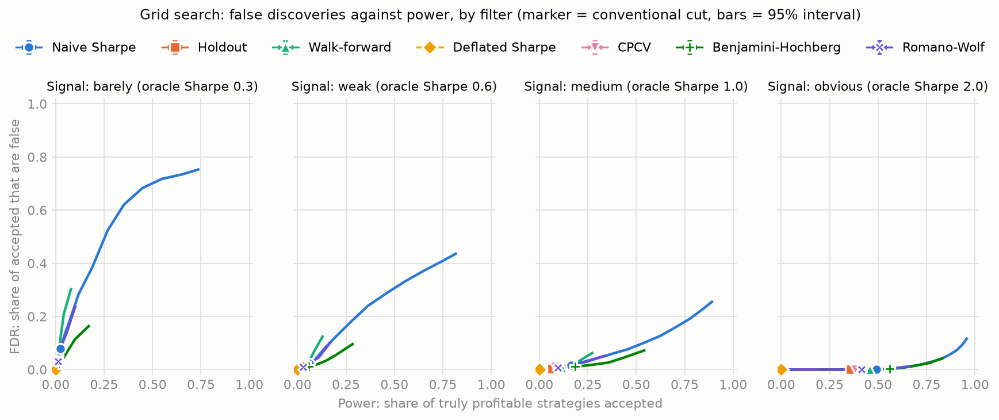

# Stage 2 results: deflated Sharpe, CPCV, Benjamini-Hochberg, Romano-Wolf

> Added later: pFDR next to FDR for every filter, in
> [exp1_grid_tables.md](exp1_grid_tables.md) and explained in the
> [Stage 3 note](stage3.md).

Reproduce with `uv run python -m overfitlab all` (about 7 minutes on 8 cores).
Same worlds, seeds and truth as Stage 1; the Stage 1 numbers are unchanged to
the last digit. The new filters see only the research sample (first 70%).

Nine filters are compared: the three from Stage 1, the deflated Sharpe ratio
in two versions, CPCV, Benjamini-Hochberg, Benjamini-Yekutieli and Romano-Wolf.

## Sources checked

| Method | Checked against | Result |
|---|---|---|
| Deflated Sharpe | Bailey & Lopez de Prado (2014), Eq. (1), (2), the worked example and Appendix A.3, read from the paper | Matches |
| Benjamini-Hochberg | Benjamini & Hochberg (1995), procedure (1), Theorem 1 and the 15 p-value example, read from the paper | Matches |
| Benjamini-Yekutieli | Benjamini & Yekutieli (2001), Theorems 1.2 and 1.3, read from the paper | Matches |
| Romano-Wolf | Clarke, Romano & Wolf (2019, IZA DP 12845), Eq. (4)-(7) and the adjusted p-value algorithm; Romano & Wolf (2005) for the block bootstrap | Matches, with one simplification (below) |
| Effective number of trials | Galwey (2009), Genetic Epidemiology 33, 559-568. **Paper is paywalled**; formula taken from the documentation of the R package poolr (`meff`) | Secondary source only |
| CPCV | Lopez de Prado (2018), ch. 12. **Book not freely available**; purging on both sides and embargo after the test set follow the skfolio library's documentation, which cites the book. Split and path counts are derived and tested by enumeration | Secondary source only |

## Where I simplified or chose

- **Romano-Wolf standard errors.** For time series the 2005 paper uses a
  kernel (autocorrelation-robust) standard error and a block-based one inside
  the bootstrap. I use the plain standard error in both places. Reason:
  without an edge, daily strategy returns are not autocorrelated, so the plain
  formula is still right for the mean; the circular block bootstrap (blocks of
  20 days, 1,000 resamples) carries the volatility clustering. The null test
  below checks that this holds up.
- **CPCV gap.** The plan said to purge training days whose lookback overlaps a
  test group. I drop 20 days on each side of every test group instead (about
  one half-life of a volatility shock at persistence 0.97). The sensitivity
  check below compares 20, 60 and 250 days.
- **CPCV minimum training length.** A split with less than one year of
  training days trades nothing. It never binds at 20 or 60 days and affects 26
  of 120 splits at 250.

## The CPCV accept/reject rule

10 groups, 3 test groups per split: 120 splits, 36 out-of-sample paths.

1. In each split, a strategy trades the test groups only if its Sharpe on the
   purged training days is at least 1.0; otherwise it is flat. A fixed-rule
   strategy has nothing else to fit, and without a decision made on training
   data all 36 paths would be the same series.
2. **Accept if the 5% quantile of the 36 path Sharpe ratios is above zero**,
   taken as the 2nd lowest, so at most one path may lose.

Why a quantile: the paths recombine the same days, so they are not independent
and a t-test across them would be far too confident. Why not one path: a single
holdout or walk-forward path can pass on one lucky period. The 5% is not a
calibrated error rate, so it is measured: on the no-signal worlds the rule
accepted 2 strategies in 200 worlds (76 strategies each), i.e. 1.0% of worlds
[0.0, 2.5] had a false discovery.

## Known-answer tests

| Test | Expected | Measured |
|---|---|---|
| Deflated Sharpe, paper example | SR_0 = 0.1132, DSR = 0.9004 | 0.1132, 0.9004 |
| Same, 46 trials; normal returns with 88 trials | 0.9505; 0.9505 | 0.9505; 0.9505 |
| Deflated Sharpe (paper), best of 50 independent null strategies accepted | under 5% | 0.3% (3 of 1,000) |
| Deflated Sharpe (variant), 25 null strategies plus their mirror images | under 5% | 0.4% (2,000 runs) |
| Effective trials: 30 independent; with mirror images added; 30 copies of one | 30; 30; 1 | 29.9; 29.9; 1.0 |
| BH, paper example at q = 0.05 | 4 rejections (Bonferroni: 3) | 4 (3) |
| BH and BY against `scipy.stats.false_discovery_control` | identical | identical |
| BH, any rejection when nothing is true, independent tests | 5% | 5.03% (4,000 runs) |
| Romano-Wolf, any false acceptance among 20 correlated null strategies with volatility clustering | 5% | 4.1% (41 of 1,000 worlds) |
| Romano-Wolf with one strategy against the t-test | same p-value | within 0.03 |
| CPCV counts for (6, 2) and (10, 3) | 15 splits / 5 paths, 120 / 36 | same |

## Filters at their conventional settings

FDR / power, pooled over the three signal types (600 worlds per column, 200
for no signal). A strategy is true if its long-run net Sharpe is at least 0.2.
Intervals are in `exp1_grid_points.csv`.

| Filter | No signal | Barely (0.3) | Weak (0.6) | Medium (1.0) | Obvious (2.0) |
|---|---|---|---|---|---|
| Naive Sharpe > 1 | 4.0% | 7.8% / 2.6% | 2.2% / 6.2% | 1.6% / 16.4% | 0.1% / 49.1% |
| Holdout | 0.0% | 0.4% / 0.3% | 0.5% / 1.3% | 0.3% / 6.6% | 0.0% / 35.8% |
| Walk-forward | 0.5% | 1.8% / 1.0% | 1.1% / 3.3% | 0.7% / 11.8% | 0.0% / 45.6% |
| Deflated Sharpe, paper | 0.0% | 0.0% / 0.0% | 0.0% / 0.0% | 0.0% / 0.0% | 0.0% / 0.0% |
| Deflated Sharpe, variant | 0.0% | 0.4% / 0.4% | 0.0% / 1.1% | 0.2% / 4.4% | 0.0% / 31.8% |
| CPCV | 1.0% | 3.1% / 1.1% | 1.3% / 3.0% | 1.1% / 8.1% | 0.1% / 38.2% |
| Benjamini-Hochberg 5% | 0.0% | 2.2% / 2.0% | 1.1% / 6.0% | 1.1% / 18.5% | 0.3% / 56.1% |
| Benjamini-Yekutieli 5% | 0.0% | 0.3% / 0.4% | 0.0% / 1.9% | 0.2% / 8.1% | 0.1% / 43.6% |
| Romano-Wolf 5% | 0.5% | 3.0% / 1.2% | 1.0% / 3.0% | 0.8% / 9.5% | 0.0% / 41.5% |

In the figure a variant shares its parent's colour and has a hollow marker.

## What the numbers say

**Benjamini-Hochberg gives the best trade-off on this grid.** With a medium
signal it finds more real strategies than the naive rule (18.5% against 16.4%)
at a lower FDR (1.1% against 1.6%), and on pure noise it accepted nothing in
200 worlds. The reason is that its bar moves: when many strategies look
significant it relaxes, when few do it tightens. A fixed Sharpe cut cannot do
that.

**BH's guarantee does not formally apply here, and Benjamini-Yekutieli is the
check.** BH is proven for independent tests (1995) and for positively
dependent ones (Benjamini & Yekutieli 2001, Theorem 1.2). A strategy and its
mirror image are perfectly negatively dependent, so the grid violates that
condition. BY (Theorem 1.3) holds under any dependence; it runs BH at the
level 0.05 / (1 + 1/2 + ... + 1/76) = 0.0102. In these simulations BH still
stayed below 5%: with the 0.2 threshold at most 2.2% pooled and 3.1% in the
worst single world type, and at most 0.2% when any positive Sharpe counts as
true. BY cuts the pooled FDR further, to 0.3% or less, and
costs roughly half of BH's power with a weak or medium signal (1.9% and 8.1%
against 6.0% and 18.5%). So the violated assumption did no visible harm on
this grid, but that is an observation, not a guarantee.

**Romano-Wolf is stricter than BH and pays for it.** It guards against even
one false acceptance and finds about half of what BH finds with a weak or
medium signal. Its power is close to BY's.

**CPCV lands close to walk-forward and Romano-Wolf**, without touching the
lockbox.

**The holdout and the deflated Sharpe variant are the most cautious filters
that still accept something.**

**Nothing rescues a barely-detectable signal.** No filter finds more than 2.6%
of the real strategies there.

**The truth threshold and the tested hypothesis are different things.** BH, BY
and Romano-Wolf test "mean return above zero", while a strategy counts as true
here only from Sharpe 0.2. A strategy with a real Sharpe of 0.1 is a correct
rejection for them and a false discovery in this table.

## Finding: the paper's deflated Sharpe ratio accepts nothing

Not one strategy passed in 2,600 worlds, at any cut down to 0.5, even where
the planted Sharpe is 2. This is the formula doing what it says, not a coding
error: the paper's own example is reproduced to four decimals.

The cause is the benchmark SR_0 = sqrt(V) x 2.43 for 76 trials, where V is the
variance of the trials' Sharpe ratios. The formula assumes that all trials have
the same true Sharpe, so that V is pure estimation noise. On this grid the
trials differ for real: where a signal exists, the strategies that follow it
have a high Sharpe and their mirror images a very negative one. V measures that
real spread, and the benchmark rises with the signal. From `truth.csv`:

| World type | SD of the 76 true Sharpes | 2.43 x SD | Best true Sharpe |
|---|---|---|---|
| No signal | 0.25 | 0.60 | 0.00 |
| Momentum, barely | 0.42 | 1.03 | 0.40 |
| Momentum, medium | 0.86 | 2.08 | 1.10 |
| Momentum, obvious | 1.60 | 3.88 | 2.27 |

The bar set by the real spread alone is above the best strategy in every row,
before any estimation noise is added. The stronger the signal, the further out
of reach the benchmark.

### The variant

Not the paper's formula; it changes the two inputs of the benchmark and
leaves the test itself alone.

- **V = 1 / (T - 1)**, the variance of a Sharpe estimate when the true Sharpe
  is zero. The general formula is (1 - skew x SR + (kurt - 1)/4 x SR^2) /
  (T - 1); at SR = 0 the skewness and kurtosis terms drop out exactly, so
  there is nothing to correct in V. The correction still acts in the test's
  own standard error, as in the paper.
- **N = effective number of independent trials** (Galwey 2009):
  (sum of sqrt(eigenvalue))^2 / (sum of eigenvalues) of the strategies'
  correlation matrix. Eigenvalues ignore the sign of a correlation, so a
  strategy and its mirror image count once. On no-signal worlds the 76
  strategies count as about 19.7 trials (range 18.0 to 20.9 over 20 worlds),
  which puts the benchmark at an annualised Sharpe of 0.72 instead of 0.92.
- The paper's own suggestion (Appendix A.3, Eq. 8-9) uses the average
  correlation. On this grid that average is -0.013, which gives N = 77: mirror
  images cancel the positive correlations, so it does not remove duplicates.

One caveat on counting mirror images once. For the *maximum* of the trial
Sharpe ratios, a strategy and its mirror image do give two chances: one of the
two is always positive. Checked on noise with 25 strategies plus mirrors: the
variant accepted something in 0.40% of 2,000 runs counting pairs once, and in
0.15% counting them twice. Both are far below 5%, because the test asks for a
Sharpe well above the expected maximum, so the choice is safe here.

Result: the variant accepts nothing on noise, has a pooled FDR of 0.4% or less
in every signal column and finds 31.8% of the real strategies when the
signal is obvious. With weaker signals it is the least powerful filter after
the holdout.

## CPCV gap sensitivity

Same rule with 20, 60 and 250 days dropped on each side of every test group,
on the first 50 worlds of each type (`exp1_cpcv_gap.csv`). Training days per
split: median 1,154 / 994 / 382.

| Gap | No signal | Barely | Weak | Medium | Obvious |
|---|---|---|---|---|---|
| 20 days | 0.0% | 4.7% / 0.4% | 2.3% / 2.1% | 2.1% / 7.4% | 0.0% / 38.6% |
| 60 days | 4.0% | 4.7% / 0.6% | 0.8% / 1.6% | 1.8% / 7.4% | 0.0% / 37.4% |
| 250 days | 0.0% | 1.6% / 0.4% | 0.0% / 0.4% | 0.7% / 2.4% | 0.0% / 17.1% |

- **20 against 60 days: no change.** Every difference is inside the 95%
  intervals (for example medium: 7.4% power both, FDR 2.1% [0.4, 4.4] against
  1.8% [0.2, 4.2]). The 4.0% on no-signal worlds at 60 days is 2 worlds of 50,
  with an interval of [0, 10].
- **250 days: same direction, different level.** Power falls by more than
  half (obvious: 17.1% against 38.6%) and FDR falls with it. The reason is
  mechanical: only about a fifth of the research sample is left for training,
  so the screen is passed less often. CPCV would then sit with the most
  cautious filters instead of next to walk-forward.

Conclusion: the comparison does not depend on 20 against 60 days, so 20 stays
the default. A 250-day gap would change where CPCV ranks on power, not whether
it controls false discoveries.

## Files

- `exp1_grid_points.csv`, `exp1_grid_curves.csv`: nine filters.
- `exp1_cpcv_gap.csv`: the gap check.
- `truth.csv`: unchanged from Stage 1.
