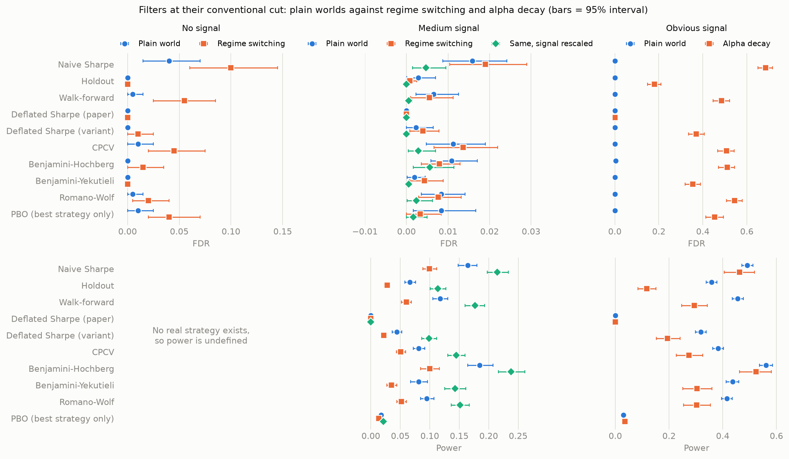

# Stage 3 results: PBO, regime switching and alpha decay

Reproduce with `uv run python -m overfitlab all` (about 12 minutes on 8 cores).
The 13 earlier world types, their truth and all earlier results are unchanged
to the last digit. Seven world types and one filter are new. A follow-up added
pFDR to every table and three regime worlds with a rescaled signal; both are
in the last two sections.

## What is new

**Filter: probability of backtest overfitting (PBO)** by combinatorially
symmetric cross-validation, checked against Bailey, Borwein, Lopez de Prado &
Zhu (2017), Algorithm 2.3 and Section 3.1, read from the paper. 16 blocks,
12,870 in-sample/out-of-sample combinations (the paper prints 12,780; C(16, 8)
is 12,870). PBO judges the whole selection process, so as a filter it can
accept at most one strategy per world: the one with the best research-sample
Sharpe, **if PBO is below 5%**. The 5% cut is my choice by analogy with a 5%
test; the paper gives no decision rule.

**Regime switching.** A hidden two-state Markov chain. Calm spells last about
250 days and crises about 50, so about one day in six is a crisis. In a crisis
the common factor's volatility triples and asset-specific volatility rises by
half. Measured against the plain no-signal world: annual volatility 23% to
29%, average correlation 0.25 to 0.39, kurtosis 7 to 11.

**Alpha decay.** The planted signal's strength halves every 5 years. Truth is
then the Sharpe a strategy earns in the **5 years after the backtest**, because
a decayed signal is real in the sample and gone afterwards. Measured on 2,000
paths per world type, so the standard error of a true Sharpe stays at 0.010
(largest 0.013), as before.

New world types, 200 worlds each:

| World type | Planted-rule Sharpe that counts as truth | True strategies of 76 |
|---|---|---|
| No signal, regimes | none | 0 |
| Momentum / cross-sectional / mean reversion, medium, regimes | 0.68 / 0.92 / 0.64 (plain: about 1.0) | 32 / 26 / 14 |
| Momentum, obvious, decay | 0.14 after the backtest | 6 |
| Cross-sectional, obvious, decay | 0.08 after the backtest | 0 |
| Mean reversion, obvious, decay | -0.07 after the backtest | 0 |

In a separate check on 300 paths (not part of `all`), the planted rule in the
decay worlds earned a Sharpe of 1.0 to 1.2 in the research sample and 0.24 to
0.43 in the lockbox. So these are worlds where a strategy looks like Sharpe 1
in the backtest and is worth almost nothing once traded.

## Known-answer tests

| Test | Expected | Measured |
|---|---|---|
| PBO, number of combinations for 16 and 4 blocks | 12,870 and 6 | same |
| PBO, one strategy always best: logit and PBO | ln(0.75 / 0.25), 0 | same |
| PBO on interchangeable noise strategies | about 0.5 | 0.487 (mean of 60 runs) |
| PBO when in-sample winners reverse out of sample | near 1 | 0.944 |
| Regimes: share of crisis days | 1/6 | within 0.04 |
| Existing worlds reproduce exactly after the simulator change | identical | identical |

## PBO on the plain worlds

| Worlds | Share of worlds where the winner is accepted | Share of those that are false |
|---|---|---|
| No signal | 1.0% | all |
| Barely | 8.2% | about half (FDR 4.2% [2.7, 5.8]) |
| Weak | 17.3% | FDR 1.0% |
| Medium | 47.3% | FDR 0.8% |
| Obvious | 96.8% | none |

PBO behaves well as a yes/no check on the best strategy: it almost never
approves a winner picked from noise and almost always approves one picked from
an obvious signal. Its "power" in the other tables is tiny by construction,
because it can accept one strategy while 14 to 34 are truly profitable.

## Regime switching

Share of no-signal worlds with at least one false discovery:

| Filter | Plain | Regimes |
|---|---|---|
| Naive Sharpe > 1 | 4.0% [1.5, 7.0] | 10.0% [6.0, 14.5] |
| Holdout | 0.0% | 0.0% |
| Walk-forward | 0.5% [0.0, 1.5] | 5.5% [2.5, 8.5] |
| Deflated Sharpe, paper | 0.0% | 0.0% |
| Deflated Sharpe, variant | 0.0% | 1.0% [0.0, 2.5] |
| CPCV | 1.0% [0.0, 2.5] | 4.5% [2.0, 7.5] |
| Benjamini-Hochberg | 0.0% | 1.5% [0.0, 3.5] |
| Benjamini-Yekutieli | 0.0% | 0.0% |
| Romano-Wolf | 0.5% [0.0, 1.5] | 2.0% [0.5, 4.0] |
| PBO | 1.0% [0.0, 2.5] | 4.0% [2.0, 7.0] |

Medium signal, FDR / power. "Rescaled" is the follow-up described below.

| Filter | Plain | Regimes | Regimes, signal rescaled |
|---|---|---|---|
| Naive Sharpe > 1 | 1.6% / 16.4% | 1.9% / 10.0% | 0.5% / 21.5% |
| Holdout | 0.3% / 6.6% | 0.1% / 2.8% | 0.0% / 11.4% |
| Walk-forward | 0.7% / 11.8% | 0.6% / 6.0% | 0.1% / 17.6% |
| Deflated Sharpe, variant | 0.2% / 4.4% | 0.4% / 2.2% | 0.0% / 9.8% |
| CPCV | 1.1% / 8.1% | 1.4% / 5.1% | 0.3% / 14.5% |
| Benjamini-Hochberg | 1.1% / 18.5% | 0.8% / 10.0% | 0.6% / 23.8% |
| Benjamini-Yekutieli | 0.2% / 8.1% | 0.4% / 3.5% | 0.1% / 14.3% |
| Romano-Wolf | 0.8% / 9.5% | 0.8% / 5.2% | 0.2% / 15.1% |
| PBO | 0.8% / 1.8% | 0.3% / 1.3% | 0.2% / 2.2% |

**On noise, regimes raise false discoveries for the rules without a
calibrated test.** The naive rule goes from 4% to 10% of worlds, walk-forward
from 0.5% to 5.5%, CPCV from 1% to 4.5%. A fixed Sharpe bar means less when
returns are more erratic. The filters built on a test with a stated level
(Benjamini-Hochberg, Benjamini-Yekutieli, Romano-Wolf, the holdout) rise at
most to 2% and stay below their 5%.

**With the same drift, regimes cost power and leave FDR about where it was.**
Every filter finds roughly half as many real strategies. The planted rule's
own Sharpe falls from about 1.0 to between 0.64 and 0.92, so this mixes two
things: more erratic volatility and a weaker signal relative to the noise.

### Follow-up: is it the volatility or the weaker signal?

Three more world types repeat the medium regime worlds with the drift scaled
up until the planted rule earns Sharpe 1.0 again (measured: 1.02, 1.04, 1.01;
kappa 0.0432 / 0.0287 / 0.0751 against 0.0316 / 0.0273 / 0.0536).

**Pooled, the power loss disappears and reverses**: every filter finds more
real strategies than in the plain worlds, at a lower FDR (last column above).
So most of the halving came from the weaker signal, not from the regimes.

**But the match is only clean for one of the three signals.** Matching the
planted rule's Sharpe does not match how hard the worlds are for the grid:

| Signal | Best grid strategy's true Sharpe: plain / regimes / rescaled | True strategies | BH power: plain / regimes / rescaled |
|---|---|---|---|
| Momentum | 1.10 / 1.01 / 1.55 | 32 / 32 / 34 | 34.8% / 18.4% / 47.0% |
| Cross-sectional | 0.94 / 0.87 / 0.99 | 29 / 26 / 29 | 13.5% / 5.9% / 8.1% |
| Mean reversion | 0.92 / 0.88 / 1.54 | 18 / 14 / 26 | 7.2% / 5.6% / 16.3% |

For momentum and mean reversion the rescaled worlds are easier than the plain
ones (the best grid rule earns Sharpe 1.5 instead of about 1), so their higher
power says little. Cross-sectional momentum is the fair comparison: the same
29 real strategies with almost the same Sharpe ratios. There, power with
regimes stays below the plain world for every filter (Benjamini-Hochberg 8.1%
[5.6, 10.8] against 13.5% [10.2, 17.0], naive 8.4% against 11.8%,
walk-forward 4.9% against 7.3%), about a third lower instead of half.

**Reading:** of the power lost under regime switching, the larger part is the
weaker signal and a smaller part (about a third of power, on the one clean
comparison) is the erratic volatility itself. One signal type with overlapping
intervals is thin evidence for the second half of that sentence.

## Alpha decay

Obvious signal, FDR at each filter's conventional cut. "After" is the truth
that matters: Sharpe of at least 0.2 in the 5 years after the backtest.

| Filter | Plain | Decay | Decay, any positive Sharpe counts | Accepted per world |
|---|---|---|---|---|
| Naive Sharpe > 1 | 0.1% | 68.5% [65.1, 71.7] | 26.8% | 5.4 |
| Holdout | 0.0% | 18.0% [14.9, 21.0] | 3.4% | 0.8 |
| Walk-forward | 0.0% | 48.6% [44.7, 52.2] | 15.4% | 2.8 |
| Deflated Sharpe, paper | 0.0% | 0.0% | 0.0% | 0.0 |
| Deflated Sharpe, variant | 0.0% | 37.1% [33.5, 40.6] | 13.5% | 1.7 |
| CPCV | 0.1% | 50.9% [46.8, 54.3] | 19.0% | 2.8 |
| Benjamini-Hochberg | 0.3% | 51.0% [47.2, 54.4] | 19.7% | 6.3 |
| Benjamini-Yekutieli | 0.1% | 35.4% [31.9, 38.8] | 12.2% | 3.0 |
| Romano-Wolf | 0.0% | 54.5% [50.7, 57.9] | 22.3% | 3.2 |
| PBO | 0.0% | 45.3% [41.3, 49.3] | 15.0% | 0.5 |

**This is the largest effect in the project so far.** Every filter that works
on the research sample lets through mostly worthless strategies: between a
third and two thirds of what they accept earns less than Sharpe 0.2 afterwards.
Multiple-testing corrections do not help, and the reason is not a flaw in
them. They answer "was there an edge in this sample?", and the answer is
correctly yes. The question that matters is "will there be one after?", and no
test on past data can see that.

**The holdout is the only filter that helps much**, at 18% against 35% to 69%,
because its lockbox is the most recent 3 years, where the signal has already
faded. It is protection through recency, not through statistics.

**The size of the effect depends on the truth threshold.** Many strategies keep
a small positive Sharpe after decay. If any positive Sharpe counts as real, the
FDRs fall to between 12% and 27% for the research-sample filters and 3.4% for
the holdout: still far above the plain worlds, but much lower. The six
strategies that count as true at 0.2 in the momentum decay world have Sharpe
ratios of 0.21 to 0.26, and 7 of 76 labels there lie within 2 standard errors
of the threshold, so that world's power figures are fragile and are left out
of this table (they are in `exp1_grid_points.csv`).

## Follow-up: pFDR next to FDR

FDR counts a world where nothing is accepted as zero. pFDR (positive FDR,
Storey 2003) averages only over the worlds where the filter accepted
something, so it answers "when this filter says yes, how often is it wrong?".
FDR = pFDR x share of worlds with an acceptance. All tables with both numbers
are in `exp1_grid_tables.md`; the two places where they tell different stories:

**Barely detectable signal** (planted Sharpe 0.3):

| Filter | FDR | pFDR | Worlds with an acceptance |
|---|---|---|---|
| Naive Sharpe > 1 | 7.8% | 49.8% [41, 59] | 15.7% |
| Holdout | 0.4% | 21.2% [0, 46] | 1.8% |
| Walk-forward | 1.8% | 32.5% [20, 46] | 5.7% |
| Deflated Sharpe, variant | 0.4% | 24.6% [3, 50] | 1.7% |
| CPCV | 3.1% | 41.4% [28, 55] | 7.5% |
| Benjamini-Hochberg | 2.2% | 37.0% [25, 50] | 6.0% |
| Benjamini-Yekutieli | 0.3% | 23.0% [3, 52] | 1.2% |
| Romano-Wolf | 3.0% | 43.3% [30, 57] | 7.0% |
| PBO | 4.2% | 51.0% [37, 65] | 8.2% |

Every filter looks safe by FDR and none is by pFDR: when a filter accepts
something in these worlds, between a fifth and a half of it is not real. The
low FDR comes from accepting almost never. PBO is the clearest case: FDR
4.2%, but the winner it approves is false half the time. The intervals are
wide because few worlds have an acceptance (7 to 94 of 600).

**Alpha decay** (obvious signal):

| Filter | FDR | pFDR | Worlds with an acceptance | pFDR, momentum decay world only | pFDR if any positive Sharpe counts |
|---|---|---|---|---|---|
| Naive Sharpe > 1 | 68.5% | 89.4% | 76.7% | 71.1% | 35.0% |
| Holdout | 18.0% | 78.9% | 22.8% | 61.4% | 14.9% |
| Walk-forward | 48.6% | 86.5% | 56.2% | 67.9% | 27.4% |
| Deflated Sharpe, variant | 37.1% | 86.2% | 43.0% | 68.3% | 31.4% |
| CPCV | 50.9% | 87.9% | 57.8% | 68.0% | 32.8% |
| Benjamini-Hochberg | 51.0% | 88.8% | 57.5% | 72.3% | 34.2% |
| Benjamini-Yekutieli | 35.4% | 87.5% | 40.5% | 72.1% | 30.0% |
| Romano-Wolf | 54.5% | 87.7% | 62.2% | 66.6% | 35.9% |
| PBO | 45.3% | 86.3% | 52.5% | 67.9% | 28.6% |

**The filters differ in how often they accept, not in how good their
acceptances are.** By FDR they spread from 18% to 69%. By pFDR they are all
between 79% and 89%. The holdout's low FDR comes almost entirely from saying
yes in 23% of worlds instead of 40% to 77%; when it does say yes, 79% of what
it accepts is still worth less than Sharpe 0.2 afterwards. Its advantage is
recency (the lockbox is the last 3 years, where the signal has already faded,
so fewer strategies pass), and it is a smaller advantage than the FDR column
suggests.

Two of the three decay world types have no real strategy at all, so pFDR is
100% there by construction; the fifth column shows the one world type that
has real strategies, and the last column the looser truth label.

## Caveats

- The regime worlds with the same drift differ from the plain ones in two ways
  at once: non-stationary volatility and a weaker signal relative to noise.
  The rescaled worlds separate the two only for cross-sectional momentum; for
  the other two signals rescaling overshoots (see the follow-up above).
- One decay speed (half-life 5 years) on one base strength (obvious). A slower
  decay would give a smaller effect.
- With decay, two of the three world types have no true strategy at all, so
  their FDR is the share of worlds in which anything was accepted.

## Files

- `exp1_grid_points.csv`, `exp1_grid_curves.csv`, `truth.csv`: now 23 world
  types and 10 filters, with pFDR columns. Pooled groups for the new worlds
  are named `all_medium_regimes`, `all_medium_regimes_matched` and
  `all_obvious_decay`.
- `exp1_grid_tables.md`: FDR / pFDR / power for every filter, written by the
  run.
- `figures/exp1_grid_regimes_decay.png`: the comparison above.
